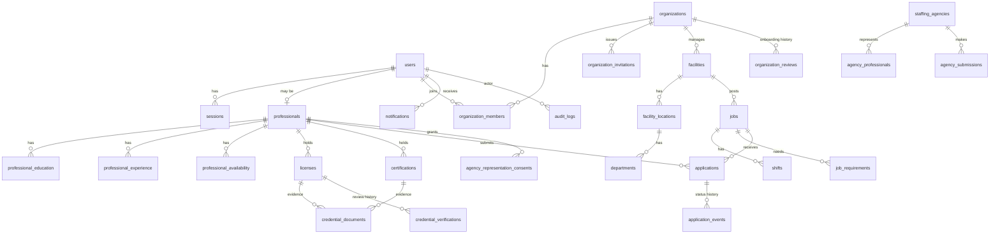

# Domain Model (draft ERD)

Draft for review; migrations are the source of truth once written.

## Principles
- UUID PKs, UTC timestamps, constrained status enums, FK + unique constraints.
- Organization-owned rows carry `organization_id`; services verify active membership; RLS backs this up.
- Account status, profile completeness, credential status and job eligibility are separate fields.
- Credential numbers are sensitive (encrypted at rest); document bytes live in private object storage, DB holds metadata only.
- Agency tables exist from the first schema pass; agency workflows ship in Release 2.
- State/jurisdiction rules live in configuration tables.
